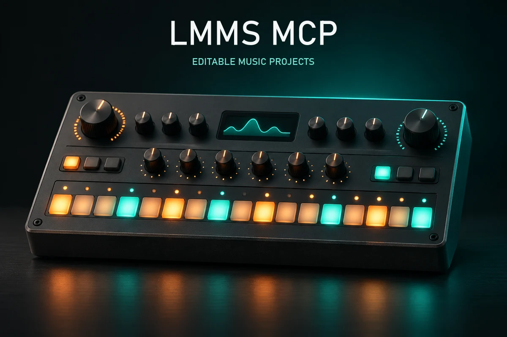

# LMMS MCP



Write game music with an AI agent and get engine-ready files back. The agent composes with chords, drum grids and melody lines, chooses from the whole stock LMMS sound library, mixes with real effects, checks its own work by measurement, and exports seamless loops, intros, adaptive layers and stingers with a manifest. The MIT-licensed server works with saved `.mmp` and `.mmpz` files and calls the installed LMMS renderer without opening the editor.

## Composer and DJ personas

Use `list_personas` to filter repository persona data by kind, tags, tempo range or search text. `describe_persona` returns the full brief and references. Pass the ID as `persona` to `compose_piece` or `compose_batch`, or use `lmms-compose --persona <id>` once the data file is installed.

Persona files live in `personas/` and follow `personas/persona.schema.json`. Explicit tempo, key, style and voice arguments override the corresponding defaults. The current composer uses native sound fallbacks, 4/4, and its existing form. It applies the persona’s phrase length, compatible drum/bass patterns, swing, harmony, and the loudness and peak settings supported by the stock renderer. Other groove, arrangement, instrument and mix references are available through `describe_persona` for the corresponding engines to consume. Four film and game score personas ship in `personas/`: see [docs/film-personas.md](docs/film-personas.md).

## Windows setup

Install Node.js 20 or newer. From a checkout run `./setup-windows.ps1`. It installs the Node dependencies and uses WinGet to install stock LMMS 1.2.2 if needed. For manual setup, run `npm ci` and install [LMMS](https://lmms.io/download). The package contains our server and demo, and setup obtains LMMS from its official distribution.

Configure a stdio MCP client with command `node` and the absolute path to `server.mjs` as its argument. Set `LMMS_WORKSPACE` to an existing directory for trusted sessions and renders. The package requires Node.js 20 or newer. It is tested with LMMS 1.2.2 on Windows x64; CI uses Node.js 22, and the server and unit tests also pass on Node.js 20.

| Variable | Purpose |
| --- | --- |
| `LMMS_WORKSPACE` | Folder for projects, renders and exports |
| `LMMS_EXECUTABLE` | Path to `lmms.exe` when it is not in Program Files |
| `LMMS_PRESETS`, `LMMS_SAMPLES`, `LMMS_PLUGINS` | Custom preset, sample and plugin folders |
| `LMMS_FFMPEG` | Path to ffmpeg for OGG output (defaults to `ffmpeg` on the PATH) |
| `LMMS_RENDER_TIMEOUT_SECONDS` | Fixed render limit; the default scales with song length |
| `LMMS_PARALLEL_RENDERS` | Renders run side by side for stems and layers (1 to 4, default 3) |
| `LMMS_SAMPLE_LIBRARIES` | Folder of open SFZ libraries for `convert_sfz` (optional, see [docs/sampler.md](docs/sampler.md)) |

To run the published package, use `npx -y @sarutobi-sasuke/lmms-mcp`. For an install that follows a fixed GitHub release, run `npx -y https://github.com/SarutobiSasuke8/lmms-mcp/archive/refs/tags/v0.9.1.tar.gz`. Configure your client to launch that command over stdio with `LMMS_WORKSPACE` set. Install LMMS separately.

On connection, the server sends a short workflow brief through MCP initialization. Call `get_started` for the same guidance, workflow entry points and local configuration. The MCP tool list documents exact parameters, including optional live tools when configured.

Stem, layer and full-song renders can take a minute or more. Give your MCP client a tool timeout of at least five minutes.

## Drum kits

Stock LMMS drum samples are grouped into ready kits, including dance-oriented ones (house, techno, trance, breaks). Call `list_drum_kits` to see which pieces are present on this machine, then `create_drum_kit` to start a project with separate tracks (kick, snare, hat, openhat, clap) ready for patterns. You can also pass the returned `factorySample` paths into `create_project` yourself.

## Tools

The saved-project tools work with stock LMMS. Claude's game-audio suite added chord, melody and drum-grid inputs, measured sound search, batch edits, mixer processing, audio analysis and adaptive game exports. Optional components extend the same project workflow with Fathom synthesis, VST3 stems and live controls.

| Area | Tools |
| --- | --- |
| Compose | `list_composer_profiles`, `create_composer_sketch`, `create_project`, `add_track`, `add_pattern`, `replace_pattern`, `copy_bars`, `edit_clip`, `edit_sample_clip`, `remove_track`, `set_song_length`, `set_project_tempo`, `resolve_chords` |
| Sounds | `search_sounds`, `preview_sound`, `list_samples`, `list_presets`, `list_instruments`, `apply_preset`, `set_native_instrument`, `build_sound_catalogue`, `render_fathom_track` |
| Mix | `set_track_mix`, `set_master`, `route_mixer_bus`, `set_bus`, `edit_effect`, `inspect_effects`, `list_effects`, `automate_track`, `apply_edits` |
| Listen | `analyze_audio`, `render_mix`, `render_stems` |
| Deliver | `export_game_audio`, `export_one_shots`, `export_midi`, `save_project_copy` |
| Read | `inspect_project`, `inspect_arrangement`, `read_pattern` |
| Start fast | `list_blueprints`, `create_from_blueprint`, `develop_motif` ([docs/blueprints.md](docs/blueprints.md)) |
| Write tunes | `write_melody`, `write_accompaniment` ([docs/melody.md](docs/melody.md)) |
| Local generation catalogue | Search, rate and backfill render and composition manifests ([docs/catalogue.md](docs/catalogue.md)) |
| Publish approved generations to R2 | `publish_to_r2` (dry run by default), `list_r2_assets` ([docs/r2.md](docs/r2.md)) |
| Nightly soundtrack runs | Headless recipe batches and dated listening pages ([docs/nightly.md](docs/nightly.md)) |
| Whole pieces | `compose_piece`, `compose_batch`, and `lmms-compose` on the command line with no agent ([docs/compose.md](docs/compose.md)) |
| Solo lines | `write_solo` |
| DJ | `list_dj_effects`, `dj_effects`, `rearrange_audio`, `time_stretch`, `chop_break` ([break editing](docs/break-edits.md)) |
| Scores and performance | `import_midi`, `shape_performance`, `master_audio` ([docs/midi-import.md](docs/midi-import.md)) |
| Phrase library | `list_phrases`, `get_phrase`, `create_from_phrases`, `add_phrase`, `save_phrase`, `rate_phrase` ([docs/phrases.md](docs/phrases.md)) |
| Browse sounds | `build_library_page`, `build_library_previews`, `tag_sound`, `list_tagged` ([docs/sound-library.md](docs/sound-library.md)) |
| See a song | `build_timeline_page` ([docs/timeline.md](docs/timeline.md)) |
| Check | `set_track_role`, `lint_arrangement`, `quality_report` ([docs/arranger-lint.md](docs/arranger-lint.md)) |
| Balance | `auto_balance`, `compare_to_reference` ([docs/balance.md](docs/balance.md)) |
| Loops | `find_loop_points`, `prepare_loop` ([docs/loop-prep.md](docs/loop-prep.md)) |
| Audition | `build_audition_page`, `read_feedback`, `remember_taste`, `get_taste` ([docs/audition.md](docs/audition.md)) |
| External instruments | `list_external_tools`, `render_vst3_stems`, `convert_sfz` ([docs/sampler.md](docs/sampler.md)) |

A beat has 48 ticks and a 4/4 bar has 192. Bars start at zero. Files use simple names in the workspace, and existing files are protected from overwrites unless a tool says otherwise.

## Composing

Every pattern takes exactly one of four inputs.

```json
{"name": "Beat", "bar": 0, "bars": 4, "steps": {"grid": "X---x---X-x-x---"}}
{"name": "Tune", "bar": 0, "bars": 4, "melody": {"line": "D5:3 F5:3 A5:6 G5:2 F5:2 | G5:3 F5:3 D5:6 r:4"}}
{"name": "Chords", "bar": 0, "bars": 8, "chords": {"progression": "Dm Bb F C", "style": "arp", "order": "updown", "rate": 2}}
{"name": "Raw", "bar": 0, "bars": 1, "notes": [{"tick": 0, "length": 44, "midi": 62, "velocity": 90}]}
```

- **Step grids** tile to fill the pattern. `X` is an accent, `x` a hit, `o` soft, `g` a ghost note and `-` a rest. The default is 16 steps per bar.
- **Melody lines** are `NOTE:steps` tokens, with an optional `:velocity`. `r:4` is a rest and `[D4,F4,A4]:8` is a chord. The line repeats to fill the pattern.
- **Chord progressions** take one chord per bar (`Dm:2` lasts two bars) and loop. `style` is `block`, `pulse`, `arp` or `bass`. Voice leading keeps chords in one register. `resolve_chords` shows the notes before you commit.
- `swing`, `humanize`, `stepsPerBar` and `transpose` are available on the generated inputs.

LMMS sizes a clip from its last note, so empty bars at the end of a song normally vanish. `create_project` pins the song to `lengthBars` (by default the last declared pattern bar), and `set_song_length` changes it later. A 45-bar loop stays 45 bars.

`copy_bars` repeats a section across tracks. `add_track` and `add_pattern` extend a saved project.

Use `edit_sample_clip` for a saved project's native audio lanes. Select a sample track by name and a clip by its start tick. `place` creates the track if needed and takes a workspace WAV, Ogg or FLAC filename and a timeline length. `move` and `duplicate` take a destination tick, `relink` takes a workspace audio filename, and `resize` changes the saved clip length in ticks. Keep the referenced audio files with the project and relink if their absolute paths change.

## Sounds

- `list_samples` browses the stock sample library (about 1,000 files). Use a result as `factorySample` on a `voice: "sample"` track, for example `drums/snare01.ogg`. Workspace WAVs work too, including one folder down, so a kit made by `export_one_shots` can be used directly.
- `voice: "preset"` loads a factory preset at creation. `apply_preset` changes it later. Both read current and older `.xpf` files and ZynAddSubFX `.xiz` patches (954 in stock LMMS).
- Some presets are saved at another base note and sound up to two octaves away from the written pitch. The default `tuning: "concert"` corrects the track so written notes sound at pitch. The result reports the measured offset and level. Pass `tuning: "preset"` to keep the preset as saved.
- `search_sounds` takes a `role` (bass, lead, pad, pluck, bell, keys, strings, brass, organ, drum, fx) and free words. Measured entries carry tags such as `bright`, `percussive` or `slow-attack`, with level and tuning. The package ships measurements for stock LMMS 1.2.2. Run `build_sound_catalogue` to measure a different installation.
- `preview_sound` renders a short audition of a preset, stock sample or Fathom patch and reports its level and detected pitch.

## Mixing and effects

`edit_effect` adds effects to an instrument track or to a mixer channel such as `Master`. `list_effects` returns every parameter with its range.

| Plugin | Parameters |
| --- | --- |
| `delay` | `time` as a note value (`1/4`, `1/8d`, `1/8t`) or seconds, `feedback`, `outputGainDb` |
| `reverb` | `size`, `dampingHz`, `inputGainDb`, `outputGainDb` |
| `compressor` | `thresholdDb`, `ratio`, `attackMs`, `releaseMs`, `kneeDb`, `makeupDb` |
| `limiter` | `ceilingDb`, `inputGainDb`, `releaseSeconds` |
| `amplifier`, `bassbooster`, `stereo` | Gain and pan, bass boost, stereo width |
| `eq`, `crossovereq` | Added at flat defaults; shape them in LMMS |

Delay times are worked out from the project tempo when the effect is written. Update the effect after a tempo change. Echo and reverb tails keep ringing after a track goes silent.

`apply_edits` runs many edits on one project and saves once. Use it for a whole mixing pass. If any edit fails, nothing is written. Pass `overwrite: true` to update a project in place.

```json
{
  "project": "theme.mmp", "output": "theme-mix.mmp",
  "edits": [
    {"op": "set_track_mix", "args": {"trackName": "Bass", "volume": 112.5}},
    {"op": "edit_effect", "args": {"trackName": "Lead", "operation": "add", "plugin": "delay", "wet": 0.25, "params": {"time": "1/8d", "feedback": 0.4}}},
    {"op": "edit_effect", "args": {"bus": "Master", "operation": "add", "plugin": "limiter"}},
    {"op": "set_master", "args": {"volume": 70}}
  ]
}
```

Volumes accept fractions. `automate_track` covers volume, pan, pitch, filter cutoff and resonance, with step, linear or smooth curves. `solo` is honoured by renders.

## Listening by measurement

An agent cannot hear. `analyze_audio` reports what it needs to judge a mix: integrated loudness in LUFS (ITU-R BS.1770), true peak, RMS, crest factor, clipped samples, DC offset, loudness range (`lraLu`), stereo correlation, stereo image (including worst-window correlation and mono-fold loss), energy in six frequency bands, spectral centroid and the loop seam. Give it `sections` in bars to compare parts of a song, `pitch: true` to detect notes, and `spectrogram` to get a PNG returned as an image. It ends with plain-language warnings, for example a section that will thin out in mono.

`render_mix` reports loudness and true peak with every render. Options:

- `tail: "wrap"` folds the reverb and delay tail back onto the start, so a loop does not cut its own echoes. `tail: "keep"` lets the tail ring out.
- `targetLufs` and `ceilingDb` master the file with a look-ahead limiter. Game music usually sits near -16 LUFS.
- An `.ogg` output name writes OGG Vorbis when ffmpeg is installed.

`render_stems` renders one aligned WAV per track, in parallel, for songs of any length.

## Game export

`export_game_audio` writes everything a game engine needs in one call.

```json
{
  "project": "theme-mix.mmp", "outputDirectory": "theme", "name": "forest-theme",
  "introBars": 4, "targetLufs": -16, "ogg": true,
  "layers": [
    {"name": "rhythm", "tracks": ["Kick", "Snare", "Bass"]},
    {"name": "harmony", "tracks": ["Pad", "Arp"]},
    {"name": "melody", "tracks": ["Lead"]}
  ],
  "stingers": [{"name": "victory", "startBar": 43, "bars": 1}]
}
```

- **Loop:** the song after the intro, with its tail folded into the start.
- **Intro:** the opening bars as a one-shot that leads into the loop.
- **Layers:** aligned loops per group of tracks for adaptive music. They share one gain and are not limited, so they sum to the mix. The manifest records how closely (`layersSumResidualDb`). Effects on Master or shared buses react to the combined signal, so keep effects on individual tracks for layered music.
- **Stingers:** short cuts from a bar range with a fade.
- **Manifest:** tempo, bars, loop points in frames, loudness, true peak and a SHA-256 for every file.

Use `export_one_shots` to process up to 32 mono or stereo 48 kHz, 16-bit PCM WAVs in one call. Give each source a unique output name and choose a new output directory. The tool trims quiet edges, adds short fades, matches sample peaks and writes mono WAVs and a JSON manifest. The manifest reports duration, trim offset and measured levels. Peak matching leaves each take's dynamics intact.

```json
{
  "outputDirectory": "rts-pack",
  "sounds": [
    {"input": "ack-source.wav", "name": "unit-acknowledged"},
    {"input": "shutdown-source.wav", "name": "robot-shutdown"}
  ],
  "thresholdDb": -48,
  "peakDb": -3
}
```

A sampler track that plays a workspace WAV stores its absolute path. Use LMMS to relink the source if you move the project to a different machine. Stock samples are stored by their library path and move with any LMMS installation.

## Visual Mix Desk

Start the local sound library server and open `/mix-desk/`, or choose **Add to desk** on a playable row in a rebuilt library page. The browser desk mixes 8 channels, resamples or records loops, and saves takes and tagged mixes into the same workspace. See [Mix Desk controls](docs/mix-desk.md).

## Fathom Atelier

Set `LMMS_FATHOM_WORKLET` to the absolute path of a trusted Fathom Atelier checkout's `public/worklets/synth-processor.js` before launching the MCP. The LMMS MCP package ships the adapter. The synth engine is supplied locally. Use `list_instruments` to check configuration and discover the stock plugin and preset inventory. The inventory checks files on disk. Third-party plugins loaded inside hosts such as Carla or VeSTige need their own inventory.

Save a full Fathom patch object as JSON in the workspace. Supported model IDs are `fathom`, `vesper` and `halo`. Call `render_fathom_track` with a saved 4/4 project at a static tempo.

```json
{
  "project": "ninja-bomber-source.mmp",
  "output": "ninja-bomber-fathom.mmp",
  "audio": "fathom-arp-stem.wav",
  "trackName": "Fathom Spark Arp",
  "patchFile": "spark-dark.json",
  "bars": 8,
  "cutoff": [
    {"tick": 0, "hz": 220},
    {"tick": 576, "hz": 375},
    {"tick": 1152, "hz": 1300},
    {"tick": 1470, "hz": 4850}
  ]
}
```

The bridge uses the written pitches, note lengths and velocities. It interpolates cutoff by frequency ratio and updates the worklet every 128 samples. The project copy keeps the muted source piano-roll track for editing and MIDI export and plays the rendered audio from a sample track. Rerun after editing notes, tempo, patch or cutoff, with fresh output filenames. The current bridge renders the dry worklet. Add delay and reverb with `edit_effect`. The audio clip references an absolute WAV path, so relink it when moving the project.

`search_sounds` lists Fathom patches only when the bridge is configured, or when you ask with `engine: "fathom"`.

## SoundFonts

`render_soundfont` renders a workspace MIDI file through a `.sf2` or `.sf3` using FluidSynth. Set `LMMS_FLUIDSYNTH` (or have `fluidsynth` on PATH) and optionally `LMMS_SOUNDFONTS`. See `docs/soundfont.md`.

## Optional Atelier groovebox tools

Link a local checkout of the private Atelier DSP engine with `npm link atelier-dsp` after registering the checkout with `npm link`, or set `LMMS_ATELIER_DSP` to the absolute path to its repository root. Use a branch that contains `src/groovebox/index.js`. The LMMS MCP server starts without the engine, and the groovebox tools report the local setup needed when called without it.

- `groovebox_pattern` builds a 16-step project with per-hit velocity and a synth bass lane with accent and slide.
- `load_pad_kit` validates a kit JSON file in `LMMS_WORKSPACE` and returns its pad data.
- `render_groovebox` writes a new stereo WAV or MIDI file in `LMMS_WORKSPACE`. For sampler pads, pass a map from each pad's asset ID to the workspace WAV file.

## Optional Atelier instrument renderers

Use the same local Atelier DSP link or `LMMS_ATELIER_DSP` setting as the groovebox tools. `render_atelier` renders a Fathom, Vesper or Halo voice from inline notes, a track in a workspace MIDI file or a track in an LMMS project. Supply a compatible workspace bank and preset, or use an installed factory preset. `render_theremin` supports timed notes, continuous pitch curves, free glide and scale snapping. Both write a 48 kHz stereo WAV to the workspace. Set `durationSeconds` to zero-pad stems to the same length, allowing room for the voice release.

## Optional Atelier workshop instruments

Set `LMMS_ATELIER_INSTRUMENTS` to the absolute path of an atelier-instruments checkout that has `agent/index.js`. The server starts without it, and the `atelier_*` tools say what to set when it is missing. See [docs/atelier-workshop.md](docs/atelier-workshop.md).

- `atelier_list_instruments` and `atelier_describe_instrument` list the instruments and give each one's JSON Schema, example and presets.
- `atelier_render` renders a generator (trailer riser and impact, game SFX, creature calls, ambience beds, vowel choir, chord pads, arpeggiator, acid bass) to a 48 kHz workspace WAV. With `place`, it also adds the WAV to a copy of a project as a sample track at a bar.
- `atelier_process` runs a workspace WAV through pump-sweep, tape-glitch or the robot voice vocoder.
- `atelier_notes` returns chord-pads, arp-lab or acid-bass notes as an LMMS pattern for `create_project`, `add_track` or `add_pattern`.

## External VST3 instruments

### Companion tool coverage

| Tool or workflow | Status |
| --- | --- |
| FluidSynth and FluidR3 GM | Tested offline from the same editable MIDI as an LMMS cue. Run FluidSynth separately. |
| Decent Sampler and Surge XT | Clean Windows setup and combined piano/pad stem render verified. Sample libraries are separate downloads. |
| Dedicated electric piano, vibraphone and orchestral libraries | FluidR3 provided a baseline. Dedicated libraries, articulation changes and large orchestral sessions remain to be tested. |
| REAPER, ACE-Step, Stable Audio and Lyria | Evaluation candidates outside the verified MCP workflow. |

The MCP package includes the VST3 adapter. Install the optional host dependencies and instruments locally to enable it. Use `list_external_tools` to see the upstream links, configured plugins and whether the selected Python has the required packages. The tool reports file presence. A render verifies whether a plugin and preset load successfully.

On Windows x64 with Python 3 installed, run `./setup-vst3-windows.ps1` from the package or checkout. It downloads pinned portable Decent Sampler and Surge XT plug-ins from their publishers, checks their SHA-256 hashes and creates an isolated host environment. Copy the generated `mcp-env.json` entries into your MCP client's environment settings and restart the client. The default destination is `%LOCALAPPDATA%/lmms-mcp/vst3-v1`. Use `-InstallDirectory` with a new directory for a separate install or to retry a failed setup. The command leaves system plug-in folders alone and sample libraries are obtained separately.

On Linux x86_64, run `./setup-vst3-linux.sh`. It builds the same isolated host environment and takes each plug-in either from a download address with a mandatory SHA-256 (`DECENT_SAMPLER_URL`, `DECENT_SAMPLER_SHA256`, `SURGE_XT_URL`, `SURGE_XT_SHA256`) or from a `.vst3` folder you already have (`--decent-sampler-bundle`, `--surge-xt-bundle`). Point the settings at the `.vst3` folders, not the `.so` inside them. See [docs/linux-real-instruments.md](docs/linux-real-instruments.md).

For manual setup, create an isolated Python environment and set its executable and both plugin locations in your MCP client environment:

```powershell
py -3 -m venv .venv-vst3
.\.venv-vst3\Scripts\python.exe -m pip install pedalboard==0.9.26 mido==1.3.3
$env:LMMS_VST3_PYTHON = (Resolve-Path .\.venv-vst3\Scripts\python.exe).Path
$env:LMMS_DECENT_SAMPLER_VST3 = 'C:\path\to\DecentSampler.vst3\Contents\x86_64-win\DecentSampler.vst3'
$env:LMMS_SURGE_XT_VST3 = 'C:\path\to\Surge XT.vst3\Contents\x86_64-win\Surge XT.vst3'
```

Download [Decent Sampler](https://store.decentsamples.com/downloads/decent-sampler/versions) and [Surge XT](https://surge-synthesizer.github.io/downloads/) from their publishers. The Windows test used the inner 64-bit VST3 binaries. Open the desired Decent Sampler library in a VST3 host and save its state as a `.vstpreset`. Copy that preset to the workspace and keep the library at the location the preset expects.

To skip the host step, use open SFZ libraries: `setup-libraries-windows.ps1` fetches a piano, upright bass, saxophone and jazz drum kit, `convert_sfz` turns any of them into a `.dspreset`, and `render_vst3_stems` plays it through `decent-sampler` with the `dspreset` option. See [docs/sampler.md](docs/sampler.md).

Export an editable LMMS arrangement with `export_midi`, then pass the MIDI filename, render duration, and named track assignments to `render_vst3_stems`. Assign each stem a configured instrument, an optional workspace `.vstpreset`, normalized parameter overrides and gain in dB. The adapter returns aligned 48 kHz stereo WAVs, a stereo mix and a manifest with the assignments and frame count. Choose a duration that covers the notes and any desired release tail. The output is a fixed-length stem render. For a game loop, set the intended loop length and check the seam before shipping.

Use `list_effects` and `edit_effect` for LMMS post-production. You can place bounced WAVs with `edit_sample_clip` and apply a master-chain compressor, limiter or reverb. For individual mixer buses, load each bounce as an AudioFileProcessor instrument track and route it with `route_mixer_bus`. Use `analyze_audio` to check levels and the seam after processing. The external VST3 adapter currently hosts instruments. The LMMS effect tools handle the post-production chain.

## Composer profiles

Search for `victory`, `whole-tone`, `counterpoint`, `jrpg`, `minimalism`, `folklore`, `sparse hub` or `orchestration` with `list_composer_profiles`. The 11 profiles include Grieg’s modal drone, Satie’s sparse accompaniment and Rimsky-Korsakov’s register exchanges. Pass a result's ID to `create_composer_sketch` with an output filename, MIDI root, tempo and bar count. The sketch works with stock LMMS and returns a suggested Fathom patch ID for its motif track. Open it in LMMS or render it with `render_mix`.

The profiles are original studies in musical techniques. `jrpg-battle` references [Nobuo Uematsu](https://www.jp.square-enix.com/music/sem/page/MODULATION/en/) and `additive-pulse` references [Philip Glass’s additive process](https://philipglass.com/recordings/two_pages/). The sketches contain original notes and stock LMMS sounds.

## Game sound effects

Use `list_samples` for installed source sounds and `preview_sound` to audition them. Layer synthesis and recordings in editable tracks using `create_project` and `edit_sample_clip`. Shape the result with `edit_effect`, render variations, then run `export_one_shots` to trim, fade and peak-match PCM WAVs and produce a batch manifest. Keep source URLs, licences and attribution with third-party assets. External library ingestion, licence-aware search, automated attribution and direct game-engine import are roadmap work.

## Codex and Claude Code skill

Copy [the LMMS game audio skill](skills/lmms-game-audio/SKILL.md) with its directory into `.agents/skills/` for Codex or `.claude/skills/` for Claude Code in your project. Configure the MCP separately using the setup above.

## Limits and roadmap

- The project builder creates 4/4 sessions at a static tempo. Tempo and master automation are edited in LMMS.
- OGG output needs ffmpeg. Without it the tools write WAV.
- Effect parameters written by `edit_effect` are kept in the project. If the project is re-saved in the LMMS editor, `inspect_effects` still lists the effects but no longer shows those parameters.
- SoundFont (`.sf2`) and VST instruments are not created by this server yet. Stock LMMS for Windows ships no SoundFont.
- The pitch detector that drives concert tuning reads one clear fundamental. Check `preview_sound` for presets with strong sub-oscillators or detuning.
- Next: SoundFont tracks, EQ band controls, tempo and master automation, sidechain ducking, and a macOS and Linux test pass.

Keep the native project as the editable master. MIDI exports instrument patterns and non-overlapping Beat/Bassline clips at a static tempo. Drum steps export as sixteenth-note triggers. Synth patches, effects, audio clips and automation stay in the native project. The default `pitchMode: "written"` preserves the piano-roll notes. Select `"playback"` to apply the instrument base note and master pitch offsets. Plugin transposition and pitch modulation remain in the native project.

Each stem is rendered with the other tracks muted and fitted to the mix length. Effects that depend on several tracks playing together can sound different in solo renders.

## Live session control

The optional Windows transport adapter uses a separately built [LMMS Agent Bridge](https://github.com/Jx9x/lmms-mcp-bridge). Launch LMMS with its bridge, then set `LMMS_LIVE_PIPE=lmms-agent-bridge` when starting this server. Where enabled, `live_transport` accepts play, pause, stop and seek. The tool returns the bridge's playback state. The upstream playback-volume cap can lower the master fader and mark your open project as modified when you press play. Saved-project edits and exports work with stock LMMS.

With the same bridge enabled, use `live_inspect` to read project state, arrangement and notes. Pass the returned project token to `live_update_track`, `live_update_clip`, `live_replace_notes` or `live_update_effect`. Take track and clip indices from a fresh arrangement read, particularly after adding or removing tracks in LMMS. Changes appear in the open project and can be saved in LMMS.

Use `live_parameters` to discover current control names, values, ranges and session-local model IDs. Set `target_type` to `song`, `track`, `instrument`, `mixer` or `effect`. Supply `target_index` for every target except `song`. For an effect, also supply `effect_index` and `effect_target_type` (`track` or `mixer`). Get the current token with `live_inspect` and refresh discovery after changing the project or replacing a plugin.

Pass the current `project_token` and a list of `{ model_id, value }` pairs to `live_set_parameters`. Use the discovered native units and ranges. The bridge validates the entire batch before applying it and returns the resulting parameter values. Changes stay in the open session until saved. This works for controls exposed by the Windows LMMS Agent Bridge. External Surge XT and Decent Sampler instruments use the offline VST3 renderer.

Use `live_create_track` for instrument, sample, automation or Beat/Bassline tracks. Create a linked curve with `live_add_automation`, inspect it with `live_read_automation` and replace or upsert points with `live_edit_automation`. The helper links to track volume, panning or pitch.

For your own synth patches, place a compatible LMMS `.xpf` in the workspace and call `live_load_instrument_file` on an instrument track. For voice clips, guitar chops and game sound effects, create an AudioFileProcessor track and load a WAV, Ogg or FLAC file from the workspace. Use a note pattern to sequence the sample. SoundFonts and other native preset formats require a compatible destination instrument.

## Verification

- `npm test` runs 13 unit tests for the analysis, composing, effect and catalogue code. It needs no LMMS.
- `node verify-game-audio.mjs` drives the server over stdio with LMMS 1.2.2 installed. It checks composing input, pinned song length, preset tuning, older presets and ZynAddSubFX patches, batch edits, effect tails, solo, stems, loudness mastering, analysis with a spectrogram, arrangement edits, the game export and sound discovery.
- `node verify-exports.mjs` checks clip edits, MIDI readback, effect bypass and stem duration. Pass a native MMP path to exercise a different project with instrument patterns at the start of the arrangement.
- `npm run verify` runs both LMMS scripts.

Set `LMMS_FATHOM_WORKLET` and `LMMS_FATHOM_TEST_PATCH` to the local worklet and a full patch JSON to also verify Fathom cutoff rendering and rebouncing.

See [the comparison notes](COMPARISON.md) for tested workflows, a survey of other LMMS servers and known gaps.

Run `npm run demo -- output/demo` to create and render two variants via the MCP. Use a fresh output folder on each run. The demo uses stock LMMS drums and built-in synthesis.

Run `node demo.mjs output/japanese --japanese` for a Japanese-inspired take with a D, E-flat, G, A and B-flat pitch palette, more space between plucked notes and sparser kick accents. The demo uses electronic synths and drums. To get closer to acoustic koto or taiko, choose suitable patches or cleared samples in LMMS.

## Licence

The bridge is MIT licensed. LMMS is separately distributed under its upstream licence.
